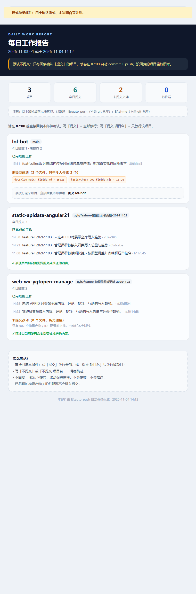

# auto_push

> 每天 00:00 汇总工作并发一封 HTML 报告邮件；每天 07:00 **只推送你回复「提交」的项目**——不回信默认不提交。

Windows / PowerShell 5.1 · 计划任务 · 本机 Cursor CLI · 本机 git

---

## 它解决什么问题

「每天自动提交推送」最怕两件事：把没做完的改动推上去、或者推送时误把构建产物带进去。

这个工具把控制权留给你：

- **00:00**：扫描配置的仓库，汇总昨天的提交、当前未提交文件、待推送提交，发一封排版好的 HTML 报告；
- **白天**：你直接回复邮件写「提交」（或「提交 项目名」）表示放行；不回信 = 不提交；
- **07:00**：只对明确回信「提交」的项目执行 `git add` → `git commit` → `git push`，并回信汇报结果；
- 构建产物、IDE 配置、Node 依赖等默认不参与提交；
- 合并 / rebase / cherry-pick 进行中的仓库自动跳过；
- 仓库存在 `state\PAUSE` 文件时，当天全部跳过。

---

## 邮件效果



每个项目一张卡片：今日提交（message + hash）、未提交文件、待推送数量、被忽略的构建产物数量；下方直接写清「回复哪句话可以放行这个项目」。

---

## 回信规则

直接回复当天 00:00 的报告邮件即可（只认你自己写的正文，引用原文不算）：

| 回复内容 | 效果 |
| --- | --- |
| `提交` | 全部项目放行 |
| `提交 项目名` | 只放行该项目，如 `提交 lol-bot` |
| `不提交` / `不提交 项目名` | 明确跳过 |
| `全部提交` / `全部不提交` | 全部放行 / 全部跳过 |
| 不回复 | 默认不提交，改动保持原样 |

- 同一项目有多条指令时，以**最新一条**为准；
- 回信必须在 07:00 前送达 Agent 邮箱；
- 07:00 之后到的回信不影响当天结果。

---

## 工作流程

```
00:00 ──> 扫描仓库 ──> 发 HTML 报告邮件
                            │
                 你白天直接回复「提交 / 提交 项目名」
                            │
07:00 ──> 读取回信 ──> 只处理确认过的项目 ──> Cursor 生成 commit message
                            │
                   git add → git commit → git push
                            │
                    发结果邮件（成功 / 未确认跳过 / 失败）
```

**确认制（默认）**：`approval.mode=required`，没有回信的项目一律不提交、不推送。

---

## 快速开始

### 1. 环境要求

- Windows 10/11，PowerShell 5.1
- [Git for Windows](https://git-scm.com/)
- Node.js（agently-cli 依赖）
- [Cursor CLI](https://cursor.com/)（用于生成 Conventional Commits 规范的 commit message；不可用时自动回退模板）
- 一个可用的 Agent 邮箱（本工具用 `@tencent-qqmail/agently-cli` 收发邮件）

### 2. 安装依赖并授权邮箱

```powershell
npm install -g @tencent-qqmail/agently-cli
agently-cli auth login
agently-cli +me
```

### 3. 准备配置

```powershell
git clone https://github.com/Tsunami06/auto_push.git E:\auto_push
cd E:\auto_push
Copy-Item config.example.json config.json
notepad config.json
```

至少修改：

- `mail.from` / `mail.to`：Agent 邮箱与收信邮箱；
- `scope.repos`：要监控的仓库绝对路径（必须是 git 仓库）；
- `pause.fromAllowlist`：只认哪些发件人的回信；
- `mail.agentlyJs`：本机 agently-cli 真实路径（`node -p "require.resolve('@tencent-qqmail/agently-cli/scripts/run.js')"` 可查）。

> `config.json` 已在 `.gitignore` 中，不会提交到仓库。

### 4. 自检

```powershell
powershell -ExecutionPolicy Bypass -File .\bin\selftest.ps1
```

建议再用计划任务环境跑一次带发信的完整自检：

```powershell
powershell -ExecutionPolicy Bypass -File .\bin\selftest.ps1 -SendMail
```

### 5. 注册计划任务

```powershell
powershell -ExecutionPolicy Bypass -File .\bin\install-tasks.ps1
```

默认注册：

- `AutoPush-NightlyReport`：每天 00:00 生成并发送报告邮件；
- `AutoPush-MorningPush`：每天 07:00 读取回信并提交推送。

想改时间：

```powershell
powershell -ExecutionPolicy Bypass -File .\bin\install-tasks.ps1 -ReportTime 23:30 -PushTime 07:30
```

### 6. 立即试跑

```powershell
# 只预览，不发邮件、不改仓库
powershell -ExecutionPolicy Bypass -File .\bin\nightly-report.ps1 -DryRun
powershell -ExecutionPolicy Bypass -File .\bin\morning-push.ps1 -DryRun

# 发一封样式预览邮件（不影响真实计划）
powershell -ExecutionPolicy Bypass -File .\bin\nightly-report.ps1 -SendPreview

# 真实跑一次（会发邮件）
Start-ScheduledTask -TaskName 'AutoPush-NightlyReport'
```

---

## 项目结构

```
auto_push/
├─ config.json              本机配置（已被 .gitignore 忽略）
├─ config.example.json      配置模板
├─ bin/
│  ├─ lib.ps1               公共库：git 采集 / 邮件 / 日志 / Cursor / 暂停检测
│  ├─ approval-lib.ps1      回信指令解析（提交 / 不提交 / 项目名）
│  ├─ report-html.ps1       HTML 报告邮件模板
│  ├─ nightly-report.ps1    00:00 每日报告
│  ├─ morning-push.ps1      07:00 自动提交推送
│  ├─ install-tasks.ps1     注册计划任务
│  ├─ uninstall-tasks.ps1   卸载计划任务
│  └─ selftest.ps1          环境自检
├─ docs/
│  └─ email-preview.png     邮件效果截图
├─ logs/                    每日日志（已忽略，保留 30 天）
└─ state/                   运行状态（已忽略）
   ├─ mail/                 发信临时正文
   ├─ preview/              预览文件
   └─ PAUSE                 应急暂停开关
```

> 本仓库自身也可以作为被监控仓库（`config.example.json` 的 `scope.repos` 第一项就是它）。

---

## 配置说明

### approval（确认制）

| 字段 | 说明 |
| --- | --- |
| `enabled` | 是否启用确认制；`false` 时回到普通自动推送 |
| `mode` | `required` = 默认不提交（推荐）；`auto` = 默认提交，回信「不提交」才取消 |
| `pushTimeLabel` | 邮件里展示的截止时间，默认 `07:00` |
| `mailKeywords` | 扫描回信用的关键词 |

### report

| 字段 | 说明 |
| --- | --- |
| `onlyActiveRepos` | 只展示当天有提交 / 有改动 / 有待推送的仓库 |
| `fileListLimit` | 每个仓库最多列多少个未提交文件 |
| `authorFilter` | `git --author` 正则；留空 = 全局 `user.email`。需要同时匹配多个身份时写 `a@x\|b@y` |

### mail

| 字段 | 说明 |
| --- | --- |
| `nodeExe` / `agentlyJs` | agently-cli 的真实入口 |
| `from` / `to` | Agent 发件地址 / 收件人数组 |
| `autoConfirm` | 计划任务发信必须为 `true`（免二次确认） |
| `sendMorningResult` | 07:00 是否发结果邮件 |
| `reportSubject` / `morningSubject` | 邮件标题模板 |

### scope（监控范围）

| 字段 | 说明 |
| --- | --- |
| `repos` | 显式监控的 git 仓库路径列表；不是 git 仓库的条目会被跳过并在报告里提示 |
| `autoDiscover` | 自动发现：`enabled` + `roots` + `maxDepth` |
| `excludeNamePatterns` | 目录名排除（默认排除 worktree `*-wt-*`、`node_modules`） |
| `excludePaths` | 路径前缀排除 |

### push

| 字段 | 说明 |
| --- | --- |
| `mode` | `active` 只处理有活动的仓库；`all` 所有有改动的仓库 |
| `remote` | 远端名，默认 `origin` |
| `guard.excludePathPatterns` | 不参与自动提交的路径/类型 |
| `guard.maxFiles` | 单仓库未提交文件超过上限则整仓跳过 |
| `commitMessage.provider` | `cursor` 用 Cursor 生成；其他值用模板 |

### pause

| 字段 | 说明 |
| --- | --- |
| `flagFile` | 应急开关文件，存在即跳过当天全部提交推送 |
| `keywords` | 仅 `approval.mode=auto` 时生效 |
| `fromAllowlist` | 只认这些发件人的回信 |
| `confirmByMail` | 暂停后是否回信确认 |
| `failClosed` | 仅 `auto` 模式：检测失败时保守跳过 |

---

## 常用命令

```powershell
# 任务状态
Get-ScheduledTask -TaskName 'AutoPush*' | Select TaskName, State
Get-ScheduledTaskInfo -TaskName 'AutoPush-MorningPush' | Select LastRunTime, NextRunTime, LastTaskResult

# 日志
Get-Content .\logs\YYYY-MM-DD.log -Encoding UTF8

# 应急暂停当天
New-Item -ItemType File -Path .\state\PAUSE -Force
Remove-Item .\state\PAUSE

# 环境自检
powershell -ExecutionPolicy Bypass -File .\bin\selftest.ps1
```

---

## 安全与隐私

- 邮件发送凭证由 agently-cli 使用 **Windows DPAPI** 加密保存，仓库里没有令牌；
- `config.json`、`logs/`、`state/` 均不进入版本库；
- 回信只认 `pause.fromAllowlist` 中的发件人，且只解析你自己写的正文；
- 构建产物、IDE 配置默认不提交；单仓库改动过多会整仓跳过，避免误提交；
- 自动提交使用 `git add <具体文件>`，不会 `git add -A` 全量入库；
- 本工具只在本机运行，不监听端口、不暴露服务。

---

## 已验证

- 00:00 报告在真实计划任务下发送成功、exit 0；
- 07:00 Cursor 生成 `feat(login): 新增用户登录接口` → 提交 → 推送成功；
- 回信「不提交」被正确识别（含时区 UTC→本地换算回归）；
- 确认制下无回信时 07:00 全部跳过；
- 真实邮件 E2E：回信 `提交 lol-bot` 被正确解析并只放行该项目；
- `selftest.ps1` 覆盖 git / PowerShell / 配置 / 时间窗 / 引用原文 / CLI 入口 / Cursor / 仓库发现 / 回信解析等，失败 0 项。

---

## License

[MIT](LICENSE)
